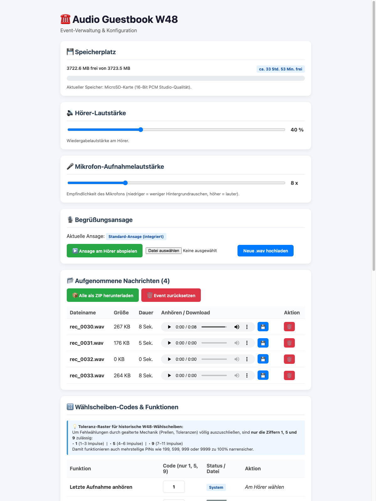
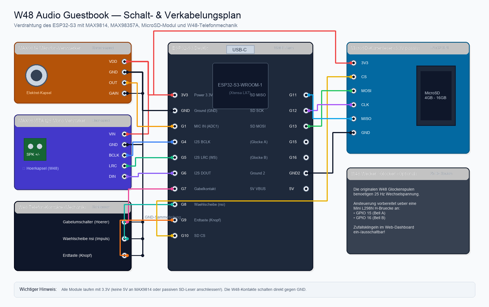

# ☎️ Universal ESP32-S3 Audio Guestbook (Vintage Telefone & DIY)

Ein universelles, autarkes **Audio-Gästebuch** auf Basis des **ESP32-S3** mit Web-Dashboard, MicroSD-Speicher (16-Bit PCM Studio-Qualität), automatischer Störgeräusch-Unterdrückung und flexibler Steuerung.

> **Universell einsetzbar:** Entwickelt und praktisch erprobt in einem historischen **W48 Bakelit-Telefon**, eignet sich dieser Code für **jedes beliebige Vintage-Telefon** (z. B. FeTAp 611/791, US-Telefone wie Western Electric 500), Tastentelefone oder eigene DIY-Gehäuse. Jeder Standard-Gabelkontakt (Schalter) und handelsübliche Impuls-Wählscheiben bzw. Taster werden direkt unterstützt.



## ✨ Features
- **Unkomprimierte 16-Bit PCM Studio-Qualität (16 kHz WAV)** direkt auf MicroSD-Karte (Fallback auf internen LittleFS-Flash).
- **100 % Störungsfreier Ton:**
  - I2S-Takt (`MAX98357A`) wird im Ruhezustand komplett gestoppt.
  - WLAN schaltet sich beim Abnehmen des Hörers vollständig ab (`WIFI_OFF`) und verbindet sich nach dem Auflegen automatisch wieder.
  - Verlustfreier Sofort-Start der Aufnahme über einen 8192-Sample RAM-Ringpuffer, während die SD-Karte im Hintergrund die Datei anlegt.
- **Erdtaste (Taster auf GPIO 9):** Unterbricht jederzeit die Ansage/Aufnahme und spielt sofort die zuletzt aufgenommene Nachricht am Hörer ab.
- **Wählscheiben-Codes (Toleranz-Raster `1`, `5`, `9`):**
  - `1`: Letzte Aufnahme anhören
  - `5`: Easter Egg 1 (Witz) anhören
  - `9`: Easter Egg 2 (Ständchen) anhören
  - `199`: Neue Begrüßungsansage direkt am Hörer aufsprechen
  - `599`: Easter Egg 1 neu aufsprechen
  - `999`: Easter Egg 2 neu aufsprechen
  - `9999`: Zufalls-Klingeln (Glocke) an-/ausschalten
- **Web-Dashboard (`http://audio-guestbook.local`):**
  - Live-Speicherplatzanzeige (MB & Stunden/Minuten)
  - Lautstärke & Mikrofon-Verstärkung (Gain) stufenlos einstellbar
  - Einzel-Download, Direkt-Player im Browser und **1-Klick ZIP-Download** aller Aufnahmen
  - Eigene `.wav`-Dateien für Ansage und Easter Eggs hochladen

## 📦 Benötigte Bauteile (BOM)

1. **W48 Tischtelefon** (historisches Bakelit-Telefon der Deutschen Bundespost, mit Hörer, Gabelkontakt, Erdtaste und N38-Wählscheibe)
2. **ESP32-S3 Entwicklungsboard** (z. B. ESP32-S3-DevKitC-1 mit 16MB Flash, 8MB PSRAM, USB-C)
3. **MAX98357A I2S Mono-Verstärker** (DAC & Verstärker für die originale Hörkapsel/Lautsprecher im W48-Hörer)
4. **MAX9814 Elektret-Mikrofonverstärker** mit AGC – *Hinweis:* Die kleine runde Elektret-Kapsel wird von der MAX9814-Platine abgelötet und wandert vorn in die Sprechmuschel des W48-Hörers (verbunden über 2 Adern des 4-adrigen Hörerkabels zurück an die Lötpads der Platine).
5. **MicroSD-Kartenleser-Modul (passiv, 3.3V)** mit SPI-Schnittstelle (ohne 5V-Spannungsregler / Level-Shifter für schnellere Signalflanken)
6. **MicroSD-Karte** (z. B. 4 GB oder 8 GB, FAT32)
7. *(Optional)* **L298N Mini H-Brücke** oder Transistorstufe zur Ansteuerung der originalen 25-Hz-Wechselstromwecker (Glocken) an GPIO 15 & 16

---

## 🔌 Verkabelungsplan & Pinbelegung

```mermaid
graph TD
    subgraph ESP32["ESP32-S3 Board"]
        3V3["3.3V"]
        GND["GND"]
        G1["GPIO 1 (ADC)"]
        G4["GPIO 4 (BCLK)"]
        G5["GPIO 5 (LRC/WS)"]
        G6["GPIO 6 (DOUT)"]
        G7["GPIO 7 (Gabel)"]
        G8["GPIO 8 (Wählscheibe)"]
        G9["GPIO 9 (Erdtaste)"]
        G10["GPIO 10 (SD CS)"]
        G11["GPIO 11 (SD MISO)"]
        G12["GPIO 12 (SD SCK)"]
        G13["GPIO 13 (SD MOSI)"]
    end

    subgraph MIC["MAX9814 Mikrofon"]
        M_VDD["VDD"] --> 3V3
        M_GND["GND"] --> GND
        M_OUT["OUT"] --> G1
        M_GAIN["GAIN"] --> GND
    end

    subgraph AMP["MAX98357A I2S Verstärker"]
        A_VIN["VIN"] --> 3V3
        A_GND["GND"] --> GND
        A_BCLK["BCLK"] --> G4
        A_LRC["LRC"] --> G5
        A_DIN["DIN"] --> G6
        A_SPK["SPK +/-"] --> HOERER["Hörkapsel (Hörer)"]
    end

    subgraph SD["MicroSD Kartenleser"]
        S_VCC["VCC (3.3V)"] --> 3V3
        S_GND["GND"] --> GND
        S_CS["CS"] --> G10
        S_MOSI["MOSI"] --> G13
        S_CLK["CLK / SCK"] --> G12
        S_MISO["MISO"] --> G11
    end

    subgraph W48["W48 Kontakte (gegen GND)"]
        W_GABEL["Gabelumschalter (Schließer)"] --> G7
        W_NSI["Wählscheibe nsi (Impulskontakt)"] --> G8
        W_ERD["Erdtaste (Knopf)"] --> G9
    end
```





### Detaillierte Anschlusstabelle

| Komponente | Pin am Modul | ESP32-S3 GPIO | Bemerkung |
| :--- | :--- | :--- | :--- |
| **Spannungsversorgung** | 3.3V / VCC | 3V3 | Für alle Module (3.3V Logikpegel!) |
| | GND | GND | Gemeinsame Masse für Module und W48-Kontakte |
| **MAX98357A (Verstärker)** | BCLK / Bit Clock | **GPIO 4** | I2S Taktleitung |
| | LRC / Word Select | **GPIO 5** | I2S Kanalumschaltung |
| | DIN / Data In | **GPIO 6** | I2S Audiodaten |
| | SPK+ / SPK- | Hörkapsel | Anschlüsse zur dynamischen Hörkapsel im Hörer |
| **MAX9814 (Mikrofon)** | OUT | **GPIO 1** | Analoges Audiosignal (ADC1) |
| | GAIN | GND / offen | Gain fest eingestellt (per Software geregelt) |
| **Gabelumschalter** | Schließer | **GPIO 7** | Gegen GND (`INPUT_PULLUP`, LOW = Hörer abgenommen) |
| **Wählscheibe** | Impulskontakt (nsi) | **GPIO 8** | Gegen GND (`INPUT_PULLUP`, 100ms Impulsserie) |
| **Erdtaste (Knopf)** | Tastkontakt | **GPIO 9** | Gegen GND (`INPUT_PULLUP`, LOW = gedrückt) |
| **MicroSD-Modul (SPI)** | CS | **GPIO 10** | Chip Select |
| | MOSI | **GPIO 13** | Master Out Slave In |
| | SCK / CLK | **GPIO 12** | SPI Clock |
| | MISO | **GPIO 11** | Master In Slave Out |
| *(Optional)* **Wecker (Glocke)** | Steuerung | **GPIO 15 & 16** | Über H-Brücke (25 Hz Umpolung) |

## 🚀 Erstinbetriebnahme & WLAN-Einrichtung

Wenn das Projekt frisch auf einen ESP32-S3 geflasht wird, richtet sich das Telefon vollautomatisch ein:

1. **Hotspot verbinden:**  
   Beim ersten Start (oder wenn das gespeicherte Heim-WLAN nicht erreichbar ist) öffnet der ESP32 automatisch einen eigenen WLAN-Access-Point:
   - **WLAN-Name (SSID):** `W48-Guestbook`
   - **Passwort:** `guestbook123`

2. **Web-Dashboard aufrufen:**  
   Verbinde dein Smartphone oder deinen Laptop mit dem WLAN `W48-Guestbook` und öffne im Browser:  
   👉 **`http://192.168.4.1`** (oder `http://audio-guestbook.local`)

3. **Heim-WLAN eintragen:**  
   Scrolle im Dashboard ganz nach unten zu **⚙️ Einstellungen (WLAN & Server)**, trage deinen normalen Heim-WLAN-Namen (SSID) und das Passwort ein und klicke auf **Speichern**.

4. **Fertig:**  
   Der ESP32 startet kurz neu, bucht sich in dein Heim-WLAN ein und schaltet den störenden Access-Point automatisch ab. Ab sofort erreichst du das Telefon ganz bequem aus deinem normalen Netzwerk unter:  
   👉 **`http://audio-guestbook.local`** (bzw. über die vom Router zugewiesene IP-Adresse).

### 🎈 Offline- / Event-Einsatz (z. B. auf Hochzeiten ohne WLAN)

Das Telefon funktioniert **vollkommen autark ohne Internet oder Heim-WLAN**:
- **Keine Einrichtung vor Ort nötig:** Einfach per USB-Netzteil oder Powerbank anstecken.
- **Glasklarer Ton:** Auch ohne Heim-WLAN schaltet der ESP32 den Hotspot bei abgenommenem Hörer sofort komplett ab (`WIFI_OFF`). Es gibt also auch auf Veranstaltungen absolut kein Rauschen oder Klackern bei der Aufnahme!
- **Aufnahmen herunterladen:** Nach dem Event verbindet sich das Brautpaar/der Kunde einfach mit dem WLAN `W48-Guestbook` (Passwort: `guestbook123`), öffnet `http://192.168.4.1` und lädt mit einem Klick alle Sprachnachrichten als fertiges **ZIP-Archiv** herunter.

---

## 🛠️ Kompilieren & Flashen (Arduino CLI)

```bash
arduino-cli compile --fqbn esp32:esp32:esp32s3:FlashSize=16M,PartitionScheme=huge_app,PSRAM=opi,CDCOnBoot=cdc audio_guestbook
arduino-cli upload -p /dev/cu.usbmodem2101 --fqbn esp32:esp32:esp32s3:FlashSize=16M,PartitionScheme=huge_app,PSRAM=opi,CDCOnBoot=cdc audio_guestbook
```


